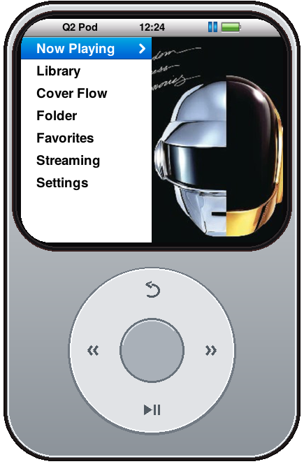
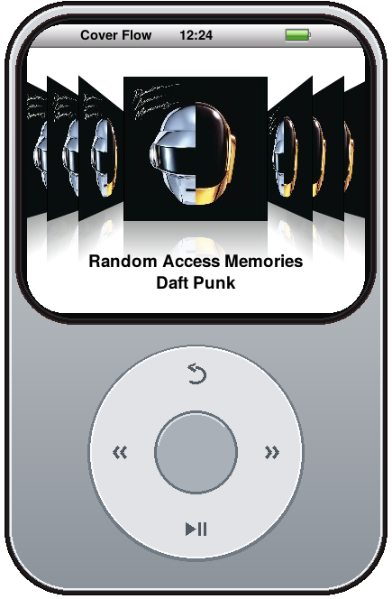
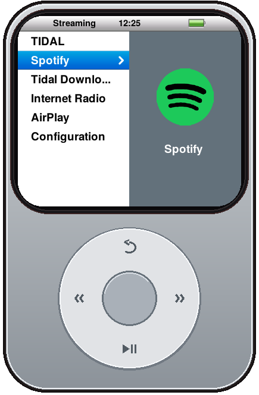
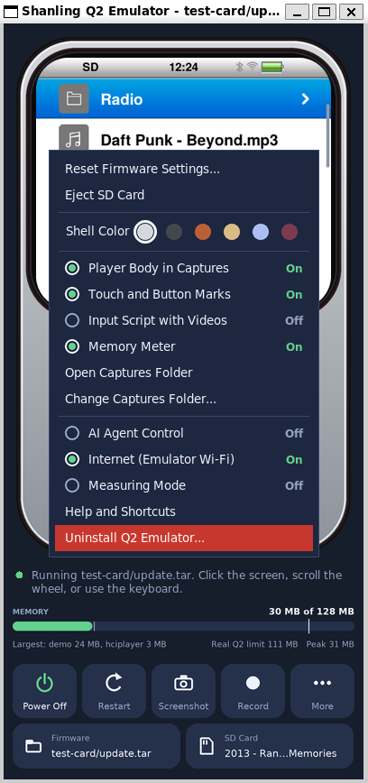

# Q2 Emulator

  

Q2 Emulator is a QEMU-based development tool for the Shanling Q2, built to run real firmware builds and test your changes directly on your computer.

**More time building, less time flashing.**

For developers: Boot the actual firmware in a virtual environment, complete with simulated display output and hardware input mapping. Inspect UI layout changes, verify screen transitions, and debug on-device navigation logic directly from your desktop. Validate each revision in QEMU and save time by skipping repeated hardware flashes until your build is ready for the player. Windows-only for now.

## Get started

Up and running in three steps:

1. **Download [Q2Emulator.exe](https://github.com/bryanmario/q2-emulator/releases/latest)** and put it in a folder of its own.
2. **Double-click it.** It sets itself up on the first launch, then opens in seconds.
3. **Click Firmware** and open your `update.tar` or firmware ZIP. Bring your own firmware; none is included.

Runs on Windows 10 and 11 with WSL 2, and offers to turn that on if it's missing. If Windows warns about an unknown publisher, choose *More info*, then *Run anyway*.

  
  
  
  
  

## What you get

- **Your firmware, live on screen.** Click the screen to touch it, scroll the wheel with your mouse wheel, and press the buttons with a click or from your keyboard.
- **Your music library as the SD card.** Point it at any folder and browse it on the player, just like the real card.
- **Screenshots and video in one click.** Capture the screen alone or the whole player.
- **Every shell color.** All six finishes, in a window you can resize freely.
- **AI agent control.** Let your coding agent drive the player and see the results.
- **Internet via Emulator Wi-Fi.** Turn it on and the player connects through your PC. Q2 Pod's App Store browses and installs apps like it does on the player.
- **Memory Meter.** Live usage against the Q2's 128 MB, with a warning when you go past what a real Q2 has.
- **Measuring Mode.** See what each action costs in processor work (the same number on any PC and on a real Q2).

  
  
  

<em>The emulator window: a firmware running, the More menu, and recording while the player's screen is off.</em>

## How close it is to a real Q2

True hardware emulation of the Q2 isn't possible yet. This is as close as it gets, and here is exactly where it stops.

| | |
|---|---|
| **Real** | Your Firmware (its code, screens and logic), Memory Size (128 MB), Dual-Core Limit, Touch, Wheel and Button Timing (all measured on a real Q2). |
| **Simulated** | Display, Touch, Wheel, Buttons, SD Card, Battery (always full), Wi-Fi (one network, through your PC's connection), Bluetooth (turns on, finds no devices). |
| **Not Available** | Sound, Real Time Playback (a track opens in Now Playing but does not progress), Bluetooth and Wi-Fi Connections to real devices and networks, Charge/Discharge, or anything else that needs the hardware itself. |

**Performance differs from a real Q2.** Measured against one: whole-number work runs about 2x faster in the emulator, decimal math about 3x slower, memory-heavy work about 29x faster. Use Measuring Mode to compare what your changes cost, then confirm on the player.

Build from source, connect an AI agent, or see how it works: [docs/DEVELOPMENT.md](docs/DEVELOPMENT.md). Licensed under GPL v3; what the download bundles is listed in [docs/THIRD-PARTY.md](docs/THIRD-PARTY.md).

> **Disclaimer:** Q2 Emulator is an evolution of an early version of [lampsonlnguyen/q2-emulation](https://github.com/lampsonlnguyen/q2-emulation), built on the amazing work done by Lampson.
