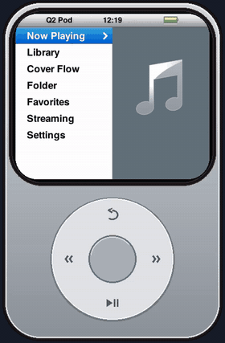

# Q2 Emulator

  

Q2 Emulator is a QEMU-based development tool for the Shanling Q2, built to run real firmware builds and test your changes directly on your computer.

**More time building, less time flashing.**

For developers: Boot the actual firmware in a virtual environment, complete with simulated display output and hardware input mapping. Inspect UI layout changes, verify screen transitions, and debug on-device navigation logic directly from your desktop. Validate each revision in QEMU and save time by skipping repeated hardware flashes until your build is ready for the player. Windows-only for now.

## Up and running in three steps

1. **Download [Q2Emulator.exe](https://github.com/bryanmario/q2-emulator/releases/latest)** and drop it into a folder of its own.
2. **Double-click it.** It sets itself up on the first launch, then opens in seconds every time after.
3. **Click Firmware** and pick your `update.tar` or firmware ZIP. Bring your own firmware; none is included.

Runs on Windows 10 and 11 with WSL 2, and offers to switch that on for you if it's missing. If Windows flags an unknown publisher, choose *More info*, then *Run anyway*.

  
  
  
  
  

## What you get

- **Your firmware, live on screen.** Click to touch, spin the wheel, press the buttons, or drive it all from your keyboard.
- **Your music library as the SD card.** Point it at any folder and browse it on the player, just like the real card.
- **Screenshots and video in one click.** Capture the screen alone or the whole player, ready to share.
- **Every shell color.** All six finishes, in a window you can size to fit your desk.
- **AI agent control.** Let your coding agent drive the player and see the results for itself.

Not available yet: real-time playback with sound, and Wi-Fi and Bluetooth connections with their settings. A song can open in Now Playing but won't show track progress.

Want to build from source, connect an AI agent, or see how it works? Head to [docs/DEVELOPMENT.md](docs/DEVELOPMENT.md). Licensed under GPL v3.

> **Disclaimer:** Q2 Emulator is an evolution of an early version of [lampsonlnguyen/q2-emulation](https://github.com/lampsonlnguyen/q2-emulation), built on the amazing work done by Lampson.
