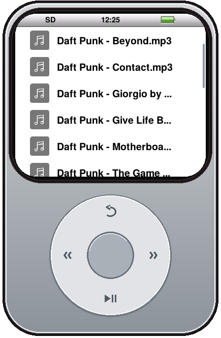
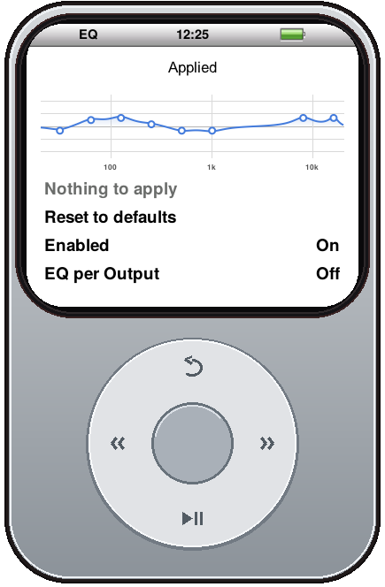
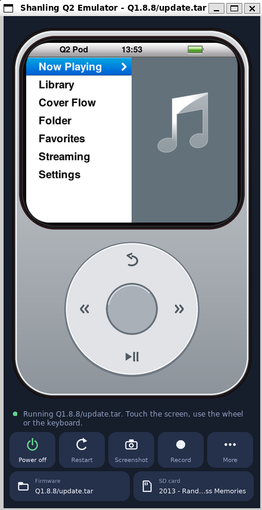
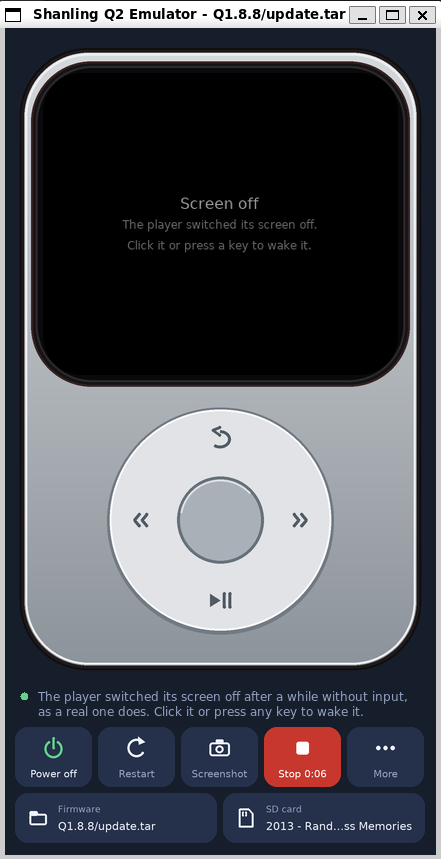

# Q2 Emulator

  

Q2 Emulator is a QEMU-based development tool for the Shanling Q2, built to run real firmware builds and test your changes directly on your computer.

**More time building, less time flashing.**

For developers: Boot the actual firmware in a virtual environment, complete with simulated display output and hardware input mapping. Inspect UI layout changes, verify screen transitions, and debug on-device navigation logic directly from your desktop. Validate each revision in QEMU and save time by skipping repeated hardware flashes until your build is ready for the player. Windows-only for now.

## Get started

Up and running in three steps:

1. **Download [Q2Emulator.exe](https://github.com/bryanmario/q2-emulator/releases/latest)** and put it in a folder of its own.
2. **Double-click it.** It sets itself up on the first launch, then opens in seconds.
3. **Click Firmware** and open your `update.tar` or firmware ZIP. Bring your own firmware; none is included.

Runs on Windows 10 and 11 with WSL 2, and offers to turn that on if it's missing. If Windows warns about an unknown publisher, choose *More info*, then *Run anyway*.

  
  
  
  
  

## What you get

- **Your firmware, live on screen.** Click the screen to touch it, scroll the wheel with your mouse wheel, and press the buttons with a click or from your keyboard.
- **Your music library as the SD card.** Point it at any folder and browse it on the player, just like the real card.
- **Screenshots and video in one click.** Capture the screen alone or the whole player.
- **Every shell color.** All six finishes, in a window you can resize freely.
- **AI agent control.** Let your coding agent drive the player and see the results.
- **Internet through a pretend Wi-Fi.** Switch it on and the player finds one network, "Emulator Wi-Fi", with your PC's connection behind it. Q2 Pod's App Store lists and installs apps as it does on the player.
- **A memory meter set to a real Q2.** See what the firmware uses of the player's 128 MB, with a warning when it takes more than a real Q2 has. Nothing is stopped.
- **Measuring mode.** Count the work each action takes. That number is the same on any PC and on a real Q2.

  
  
  

<em>The emulator window: a firmware running, the More menu, and recording while the player's screen is off.</em>

## How close it is to a real Q2

True hardware emulation of the Q2 is not possible today. This gets as close as it can, and says where it stops.

| | |
|---|---|
| **Real** | Your firmware's own code, screens and logic. The memory size, the two cores, and the timing of touch, wheel and buttons, all measured on a real Q2. |
| **Simulated** | The screen, touch panel, wheel, buttons, SD card and battery (always full). Wi-Fi is one pretend network. Bluetooth switches on and finds nothing. |
| **Not there** | Sound, the real radios, charging, and anything else that needs the hardware itself. A song opens in Now Playing but does not advance. |

**Speed is not the Q2's.** Against a real Q2, on one PC: whole-number work ran about 2 times faster here, decimal math about 3 times slower, and work spread over a lot of memory about 29 times faster. Use measuring mode to compare what your changes cost, and test on the player before you ship.

Build from source, connect an AI agent, or see how it works: [docs/DEVELOPMENT.md](docs/DEVELOPMENT.md). Licensed under GPL v3; what the download bundles is listed in [docs/THIRD-PARTY.md](docs/THIRD-PARTY.md).

> **Disclaimer:** Q2 Emulator is an evolution of an early version of [lampsonlnguyen/q2-emulation](https://github.com/lampsonlnguyen/q2-emulation), built on the amazing work done by Lampson.
